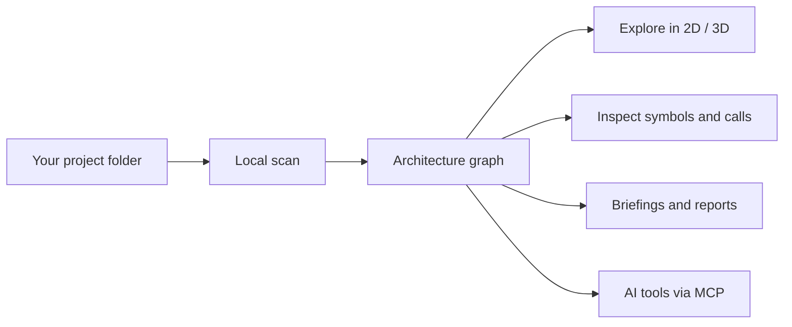

# Pathfinder

### See how your code connects. Plan what comes next.

Explore your codebase as an interactive architecture map. 
Trace connections, dive into functions, and give your AI assistant structural context.

**[Download](#download-pathfinder)** · **[Get started](#get-started)** · **[What you can do](#what-you-can-do)** · **[Release notes](https://github.com/SquareBeret/Pathfinder-Releases/releases/tag/v0.1.4)**

---

An unfamiliar repository has a lot to tell you. Pathfinder gives you a map to explore it: files, imports, function calls, routes, services, configuration, and the connections between them.

Run it on your own machine, choose a project folder, and explore in your browser. **Node.js is bundled. Your source stays local during scanning.**

## Download Pathfinder

**Current release: [v0.1.4 — beta](https://github.com/SquareBeret/Pathfinder-Releases/releases/tag/v0.1.4)**

| Your computer | Download |
| --- | --- |
| Windows 10 or later · 64-bit Intel / AMD | **[Windows ZIP](https://github.com/SquareBeret/Pathfinder-Releases/releases/download/v0.1.4/pathfinder-win-x64.zip)** |
| macOS · Apple Silicon | **[Mac ARM64 ZIP](https://github.com/SquareBeret/Pathfinder-Releases/releases/download/v0.1.4/pathfinder-mac-arm64.zip)** |
| macOS · Intel | **[Mac Intel ZIP](https://github.com/SquareBeret/Pathfinder-Releases/releases/download/v0.1.4/pathfinder-mac-x64.zip)** |
| Linux · 64-bit Intel / AMD | **[Linux ZIP](https://github.com/SquareBeret/Pathfinder-Releases/releases/download/v0.1.4/pathfinder-linux-x64.zip)** |

[All releases](https://github.com/SquareBeret/Pathfinder-Releases/releases) · [SHA-256 checksums](https://github.com/SquareBeret/Pathfinder-Releases/releases/download/v0.1.4/SHA256SUMS.txt)

Download the ZIP for your platform from the table above. GitHub's automatic **Source code** archives are not the application.

## Get started

1. **Extract the whole ZIP** into a folder.
2. **Launch Pathfinder.**
   - **Windows:** double-click `pathfinder.exe` or `pathfinder.bat`.
   - **macOS / Linux:** open Terminal in the extracted folder and run `./pathfinder.sh`.
3. **Choose a project folder** in the browser and run a scan.
4. **Explore the graph.** Open a module's deep dive to inspect its functions and calls.

Keep the extracted files together. The package includes the runtime and companion VS Code extension; no Node.js or npm installation is needed.

The live UI normally opens at **http://localhost:4317**. Keep the server's terminal window open while using it; press **Ctrl+C** to stop.

> **macOS:** the builds are unsigned. Your Mac may require approval in **System Settings → Privacy & Security**. Windows startup and the project picker are checked automatically; macOS and Linux builds still need broader testing on users' machines.

## What you can do

| Explore | Investigate | Plan |
| --- | --- | --- |
| Browse an interactive **2D or 3D architecture graph**. | Follow imports, calls, routes, services, and configuration relationships. | Add planned modules and describe their intended roles. |
| Deep dive from a module into its **functions and symbols**. | Ask what connects to a component, what calls it, and what a change could affect. | Work in isolated **planning branches**. |
| Filter the view and save your layout, including depth. | Compare scan snapshots and export Markdown, HTML, or JSON. | Compare the existing structure with your intended design. |

### From repository to useful context

### Give your AI assistant a map

Pathfinder exposes project-scoped tools through **MCP**, with integrations for **Claude Code, Codex, and VS Code / Copilot**.

An assistant can request an architecture briefing, inspect a component's neighborhood, find callers, explore possible change impact, and drill into a module before opening source files. Generated briefings provide context for people too.

**The graph is structural evidence.** It helps you find where to look; confirm important conclusions in source. Dynamic dispatch, indirect calls, and framework behavior can be incomplete.

### Scan across languages

File-level parsing covers **JavaScript / TypeScript, Python, Go, Java, C / C++, Rust, and PHP**, with additional detection for shell launchers and HTML / CSS asset references.

Detailed symbol-call exploration is available for **JavaScript / TypeScript and Python**. Coverage varies by language and coding pattern.

## Local data, portable application

- **No account required** to scan and explore a project.
- **No source-code upload** as part of normal scanning.
- Each project keeps its database, reports, exports, and planning branches in a local **`.pathfinder/`** folder.
- Recent-project preferences are stored locally for your user account.
- AI integrations use the client you configure; that client's data handling applies when you use it.

## What's new in v0.1.4?

- Double-click the packaged executable to open the UI.
- Scans of the same project wait for one another across the UI, CLI, MCP, and API.
- Bare method names resolve in queries, with candidates shown for ambiguous names.
- 3D depth persists across launch methods, and symbol layouts spread through a volume.
- Descriptions carry dates; AI briefings separate test fixtures from runtime architecture.

**[Read the full v0.1.4 release notes →](https://github.com/SquareBeret/Pathfinder-Releases/releases/tag/v0.1.4)**

## Feedback

Pathfinder is in beta. [Report an issue](https://github.com/SquareBeret/Pathfinder-Releases/issues) with your operating system, Pathfinder version, what you tried, and any terminal error text. Please remove private code and sensitive paths before posting.

This repository hosts the downloadable releases. The application's source repository is maintained separately.
